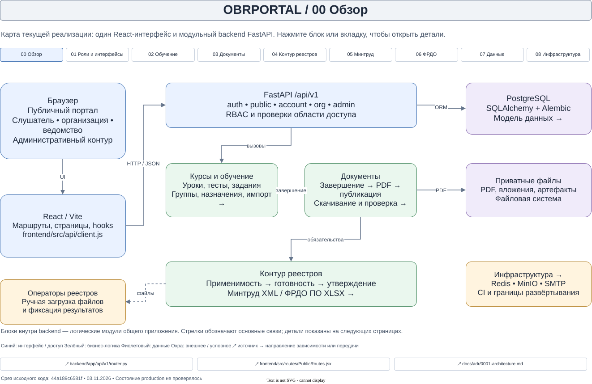

# Архитектурная карта OBRPORTAL

[Открыть редактируемую карту в diagrams.net](https://app.diagrams.net/?mode=device#Uhttps%3A%2F%2Fraw.githubusercontent.com%2Fdisa-ufa%2Fobrportal%2Fdocs%2Farchitecture-map-20261103%2Fdocs%2Farchitecture%2Fobrportal-architecture.drawio) · [Исходный файл .drawio](obrportal-architecture.drawio)

Карта показывает текущую структуру **исходного кода** на коммите [`44a189c6581fe`](https://github.com/disa-ufa/obrportal/commit/44a189c6581fe1b6f0fcfe68dbda4d53b00ef7f8), проверенном 3 ноября 2026 года. Она не подтверждает, что этот же код или конфигурация развёрнуты в production.

Это один файл с девятью страницами. Блоки, подписи и соединители — обычные объекты draw.io, которые можно перемещать и редактировать по отдельности. XML сохранён без сжатия, чтобы изменения было проще просматривать в Git.



Изображение выше — статический предпросмотр. Межстраничная навигация работает в исходном `.drawio`, открытом в draw.io/diagrams.net.

## Как открыть и работать вместе

1. Скачайте `obrportal-architecture.drawio` и откройте его в установленном draw.io через **Файл → Открыть**. Либо используйте ссылку на веб-редактор выше: она загружает файл из ветки этого PR.
2. Начните со страницы **00 Обзор**. Верхние кнопки ведут на детальные страницы; **00 Обзор** возвращает назад. В редакторе выделите блок и нажмите ссылку во всплывающей панели. Страницы доступны и через нижние вкладки.
3. Ссылки **↗** внизу страницы и ссылки у отдельных модулей открывают исходники на зафиксированном коммите GitHub. Внутренние переходы работают без интернета; для GitHub нужен доступ к сети.
4. Меняйте текст двойным щелчком, перемещайте блоки, добавляйте связи за маркеры соединения. У стрелок сохранены привязки к объектам.
5. Сохраняйте `.drawio` в отдельной рабочей ветке и отправляйте изменения через PR. Веб-ссылка открывает локально сохраняемую копию; сохранение в браузере само по себе не отправляет коммит в GitHub.

Перед началом правок получите последнюю версию ветки. Лучше заранее разделить работу по страницам: GitHub хранит версии, но не превращает локальный файл в доску одновременного редактирования. Не заменяйте стабильные ID страниц: ссылки используют их, а не названия вкладок. После изменения кода обновляйте дату среза, ссылки на источники и соответствующие страницы карты.

После слияния PR веб-ссылку можно перевести на `main`. До слияния она специально указывает на `docs/architecture-map-20261103`. Не удаляйте эту ветку, пока ссылка не обновлена.

## Страницы

| Страница | Что показывает | Основные источники |
| --- | --- | --- |
| 00 Обзор | React, единый backend, бизнес-модули и хранилища | `backend/app/api/v1/router.py`, `frontend/src/routes/PublicRoutes.jsx` |
| 01 Роли и интерфейсы | Гость, слушатель, организация, ведомство, администратор и операторы; auth и RBAC | `backend/app/api/v1/rbac.py`, `backend/app/db/seed.py` |
| 02 Обучение | Конструктор, назначения, уроки, тесты, задания, импорт и завершение | `account.py`, `enrollment_completion.py`, `learner_import_batches.py` |
| 03 Документы | Черновик, PDF, публикация, скачивание, публичная проверка и отзыв | `completion_documents.py`, `document_storage.py`, `public.py` |
| 04 Контур реестров | Применимость, готовность, утверждение, защита действий, попытки, пакеты, результаты | `compliance_registry_contract.py`, `registry_applicability_export_guard.py`, `registry_batch_transaction.py` |
| 05 Минтруд | Кандидаты, протокол, фиксация, сверка, синхронизация, XML и ручной этап | `mintrud_protocol_drafts.py`, `mintrud_protocol_sync.py`, `mintrud_eisot_xml.py` |
| 06 ФРДО | Контекст, путь ПО, рабочий XLSX-шаблон, пакет и результат | `frdo_po_portal_contract.py`, `frdo_po_portal_artifact.py`, `frdo_po_batches.py` |
| 07 Данные | Основные сущности PostgreSQL и связи | `backend/app/models/`, `backend/alembic/versions/` |
| 08 Инфраструктура | Compose, Redis, MinIO, приватные файлы, SMTP, health/readiness и CI | `docker-compose.yml`, `system.py`, `.github/workflows/ci.yml` |

Это обзор основных зависимостей и процессов. Он не заменяет полную ER-модель, спецификацию API или машину состояний: не все FK, ошибки, ветвления и допустимые переходы помещены на схемы. Блоки backend обозначают логические области одного приложения, а не отдельно развёрнутые сервисы.

## Что уточнено по текущему коду

- [ADR-0001](../adr/0001-architecture.md) описывает модульный монолит, S3 и будущие фоновые задачи. Текущий `document_storage.py` сохраняет PDF и артефакты в приватную файловую систему. MinIO есть в Compose и S3-проверке readiness. Отдельный worker/очередь задач в проверенном приложении и Compose не обнаружен.
- Redis используется для ограничения запросов регистрации/восстановления доступа и readiness. SMTP работает при включённой доставке писем; состояние production-настроек не проверялось.
- Завершение назначения обеспечивает `DocumentRecord` со статусом `draft`, PDF и реестровые обязательства. Публикация (`available`) и отзыв (`revoked`) — отдельные действия. Публичная проверка по коду не требует предварительного скачивания PDF.
- Применимость реестра (`required`, `not_required`, `needs_review`) отделена от готовности, утверждения и права выполнить экспорт. В карте отражены проверки актуальности, блокировки и отдельный флаг пакетных выгрузок; его реальное значение в production неизвестно.
- В Минтруде черновик/печать протокола, `record-check`, `registry-sync` и экспорт разделены. Реализован XML по встроенной XSD 1.0.9. Автоматический вызов внешнего API отправки не обнаружен: показана передача файла оператором и фиксация результата в OBRPORTAL.
- Для ФРДО ПО реализован XLSX по шаблону со статусом `working_reference`. Общий контракт артефакта ФРДО остаётся `unconfirmed`. Готовность пути ПО нельзя переносить на другие типы программ; карта не подтверждает приём файла государственным порталом.
- Seed содержит и роли для будущих направлений. Само наличие `finance_operator` или `edo_operator` не доказывает реализацию платежей либо ЭДО. Кабинет ведомства сейчас предназначен для просмотра закреплённых профилей организаций.

## Безопасная область изменений

Работа начата от `main` на указанном коммите в новой отдельной копии репозитория и ветке `docs/architecture-map-20261103`. Начальное рабочее дерево после извлечения файлов было чистым. Репозиторий публичный; `main` защищён проверкой `Test ObrPortal`, список rulesets на момент проверки пуст. Проверены действующий [процесс разработки](../development-process-v2.md) и CI: PR запускает проверки, production-деплой является отдельным действием.

Все добавления находятся в `docs/architecture/`. Существующие файлы приложения, миграции, конфигурация, release manifest и рабочие копии проекта не изменялись. Production, базы данных и серверы не использовались; deploy, миграции, seed, запуск Docker и слияние PR не выполнялись. В файлах карты нет учётных данных, личных записей пользователей или адресов production-серверов.

## Проверка и поддержка

Из корня репозитория:

```text
python docs/architecture/validate_drawio.py
```

Проверка не запускает приложение и не подключается к БД. Она проверяет XML, уникальность ID, страницы и их навигацию, концы соединителей, положение и отсутствие пересечений блоков, редактируемость фигур и наличие файлов-источников в Git на зафиксированном коммите. Для последней проверки этот коммит должен присутствовать в локальной истории.

Результаты текущей проверки и ограничения ручной проверки перечислены в [VALIDATION.md](VALIDATION.md).

Формат файла и внутренние ссылки соответствуют [описанию формата draw.io](https://github.com/jgraph/drawio/wiki/File-Format); [официальная справка о страницах](https://www.drawio.com/docs/manual/pages/) описывает навигацию и редактирование многостраничных схем.
